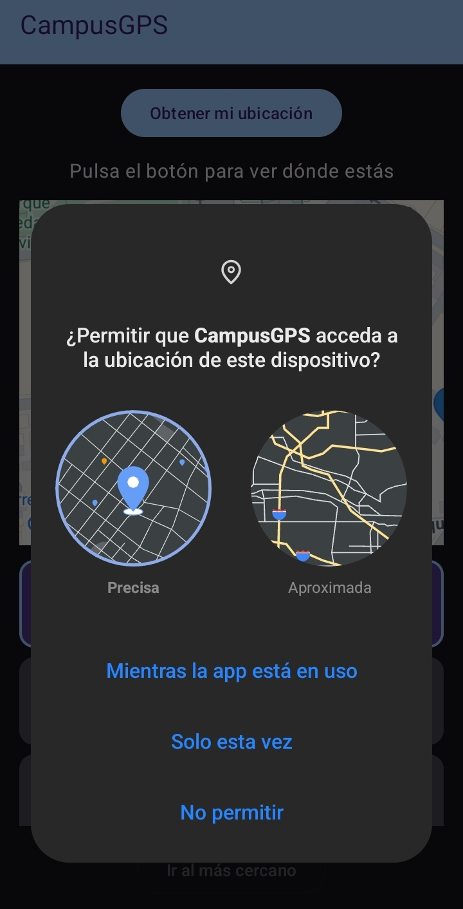
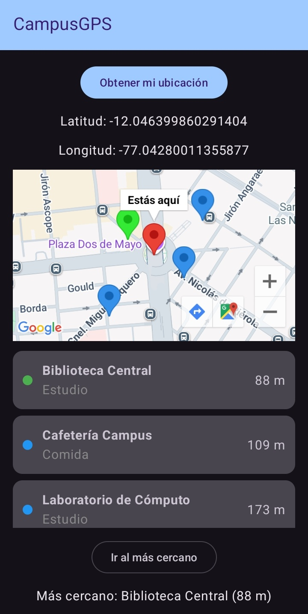
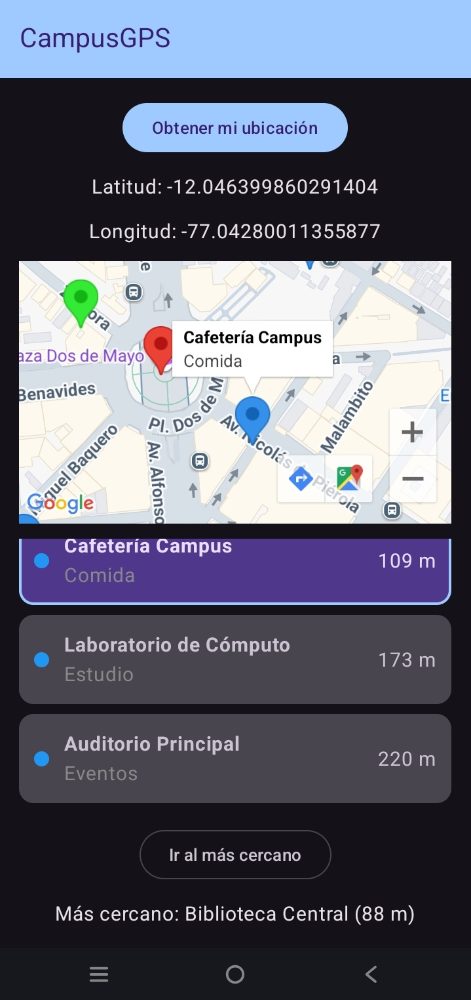
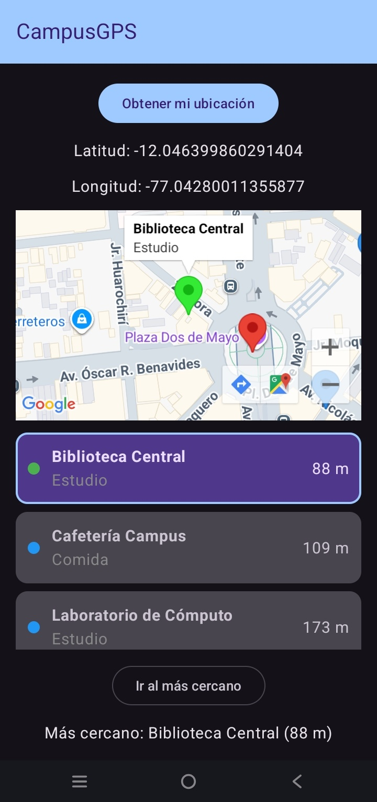
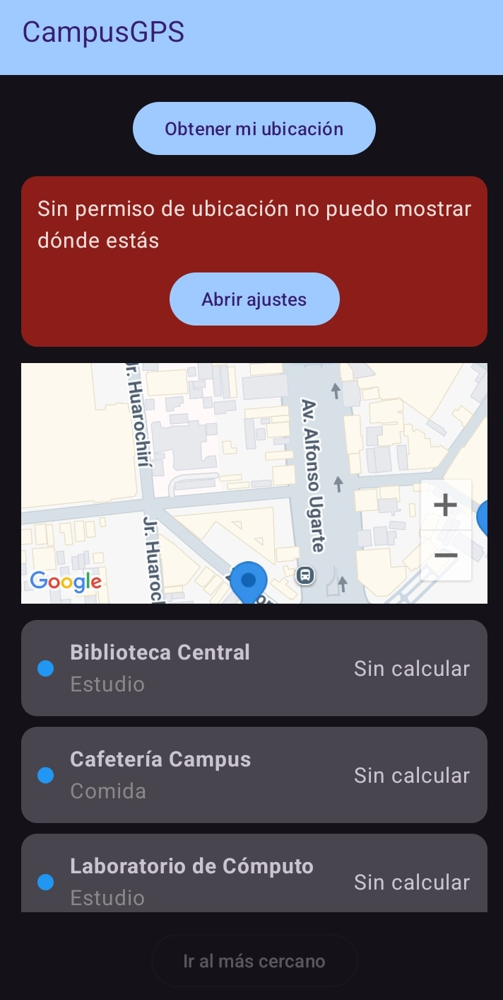

# CampusGPS

**Alumno:** José Rojas Condor
**Curso:** Programación en Móviles — Laboratorio 13: Localización Geográfica
**Docente:** Juan León S.

## Descripción

CampusGPS es una app Android hecha con **Kotlin + Jetpack Compose + Material 3**. Obtiene la ubicación del celular, la muestra en un mapa de Google y te dice qué lugar del campus tienes más cerca. Se ven cinco lugares ficticios (Biblioteca, Cafetería, Laboratorio, Auditorio y Estacionamiento) con su distancia en metros, ordenados del más cercano al más lejano. El más cercano se marca en verde y con el botón **Ir al más cercano** la cámara viaja hasta él.

La app sigue funcionando aunque el usuario niegue el permiso, apague el GPS o el celular no tenga Google Play Services: en cada caso muestra un mensaje claro y un botón útil (**Abrir ajustes** o **Reintentar**).

**Tecnologías:** Google Play Services Location (`FusedLocationProviderClient`), Maps Compose, ViewModel + StateFlow, patrón **MVVM + Repository**.

## Estructura de paquetes

```
com.rojas.campusgps/
├── MainActivity.kt                   Crea el ViewModel con la Factory y muestra la pantalla
├── model/
│   └── Modelos.kt                    Posicion, Lugar, LugarConDistancia, TipoError, UbicacionUi
├── data/
│   ├── UbicacionRepository.kt        interface: obtenerPosicion() y playServicesDisponible()
│   ├── UbicacionRepositoryGoogle.kt  implementación con FusedLocationProviderClient
│   ├── LugaresRepository.kt          interface: obtenerLugares()
│   └── LugaresRepositoryLocal.kt     los 5 lugares ficticios
├── util/
│   ├── Distancia.kt                  distanciaMetros() con Location.distanceBetween
│   └── Formato.kt                    formatearDistancia(): "350 m" o "1.5 km"
├── viewmodel/
│   ├── MapaViewModel.kt              estado, lugares, seleccionado y masCercano (StateFlow)
│   └── CampusViewModelFactory.kt     crea el ViewModel con sus repositorios
└── ui/
    ├── PantallaMapa.kt               pantalla principal y pedido de permisos
    ├── MapaUbicacion.kt              GoogleMap con la cámara y los marcadores
    ├── ListaLugares.kt               LazyColumn con las tarjetas de lugares
    ├── MensajeError.kt               recuadro de error con su botón según el tipo
    └── theme/                        colores y tipografía
```

## Arquitectura MVVM + Repository

```
View (PantallaMapa, MapaUbicacion, ListaLugares, MensajeError)
   |  evento: pulsar el botón / tocar una tarjeta      ^ collectAsState()
   v                                                   |
ViewModel (MapaViewModel) ------- StateFlow ----------->
   |  llama solo a las interfaces
   v
UbicacionRepository  --->  UbicacionRepositoryGoogle (FusedLocationProviderClient)
LugaresRepository    --->  LugaresRepositoryLocal (los 5 lugares fijos)

util/ (distanciaMetros, formatearDistancia): funciones puras, sin estado
```

| Capa | Conoce a | No hace |
|---|---|---|
| View (`ui/`) | Solo a su ViewModel | No usa Repository ni Fused, no calcula distancias |
| ViewModel | Solo a las interfaces de Repository | No conoce Composables ni recibe `Context` |
| Repository | Google Play Services | No expone clases de UI |
| `util/` | Nada | No guarda estado |

## Configuración de la clave de Maps

La clave de API **no está en el código ni en el repositorio**. Se guarda en `local.properties` (que está en `.gitignore`):

```
MAPS_API_KEY=<clave creada en Google Cloud>
```

`app/build.gradle.kts` lee ese archivo y la pasa al Manifest con `manifestPlaceholders["MAPS_API_KEY"]`, y el Manifest la usa en el `<meta-data android:name="com.google.android.geo.API_KEY" android:value="${MAPS_API_KEY}" />`. La clave está restringida en Google Cloud al paquete `com.rojas.campusgps` y a la huella SHA-1 de mi equipo.

## Capturas

Probado con la ubicación en el punto base `-12.0464, -77.0428`.

| Permiso | Mapa con mi ubicación | Marcadores |
|---|---|---|
|  |  |  |

| Lista ordenada | Error (permiso denegado) |
|---|---|
|  |  |

## Para pensar

**1. ¿Por qué `FusedLocationProviderClient` está dentro del Repository y no en el ViewModel?**
Porque el Repository es la capa que habla con las fuentes de datos, en este caso Google Play Services. Fused necesita un `Context` para crearse, y el ViewModel no debe recibir `Context` porque vive más que la Activity (sobrevive a la rotación) y podría causar fugas de memoria. Además, el ViewModel solo conoce la interfaz `UbicacionRepository`, así que si mañana cambio la forma de obtener la ubicación (otra librería o datos falsos para pruebas) solo cambio la implementación y el ViewModel queda igual.

**2. ¿Qué diferencia hay entre el permiso de ubicación y la clave de API de Maps? ¿Qué pasa si falta cada uno?**
El **permiso** lo da el usuario en tiempo de ejecución y autoriza a la app a leer la ubicación del celular. La **clave de API** identifica a mi app ante Google para poder descargar y mostrar el mapa. Son dos servicios distintos.
- Si falta el **permiso**: no se puede obtener la ubicación, la app muestra "Sin permiso de ubicación…" con el botón **Abrir ajustes**, pero el mapa sí se ve.
- Si falta la **clave** (o está mal): el mapa sale gris o en blanco y en Logcat aparece *Authorization failure*, pero la ubicación, las distancias y la lista sí funcionan.

**3. ¿Por qué la clave va en `local.properties` y no en el código? ¿Qué harías si se subiera a GitHub por error?**
Porque `local.properties` está en `.gitignore` y nunca se sube al repositorio. Si la clave estuviera en el código, cualquiera que vea el repo podría copiarla y usarla con mi cuenta de Google Cloud. Si se subiera por error, la **borro en Google Cloud y creo una nueva**, porque la anterior ya no es segura aunque luego la quite del código (queda en el historial de Git). Después reviso el `.gitignore` y verifico con `git grep` que no quede ninguna clave.

**4. ¿Dónde calculas la distancia y por qué no en el Composable?**
En `util/Distancia.kt` (`distanciaMetros`, con `Location.distanceBetween`), y la llamo desde el ViewModel en `actualizarDistancias()`, solo cuando la ubicación llega con éxito dentro de `buscar()`. No va en el Composable porque los Composables se recomponen muchas veces y solo deben dibujar según el estado; si calculo ahí, rompo MVVM, repito el cálculo en cada recomposición y la lógica no se puede probar por separado. El ViewModel publica la lista ya ordenada y la pantalla solo la muestra.

**5. ¿Qué pasa con tu app si el usuario niega el permiso dos veces? ¿Cómo lo manejas?**
A partir de Android 11, si el usuario niega dos veces, Android ya no vuelve a mostrar el cuadro de permiso: el lanzador responde "denegado" al instante. En mi app eso llama a `vm.permisoDenegado()`, que muestra el mensaje de error con el botón **Abrir ajustes**. Ese botón abre la pantalla de la app en Ajustes (`Settings.ACTION_APPLICATION_DETAILS_SETTINGS` con `Uri.fromParts("package", packageName, null)`) para que el usuario active la ubicación a mano. La app nunca se cierra.
